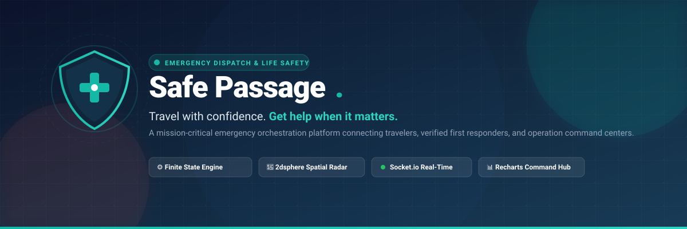
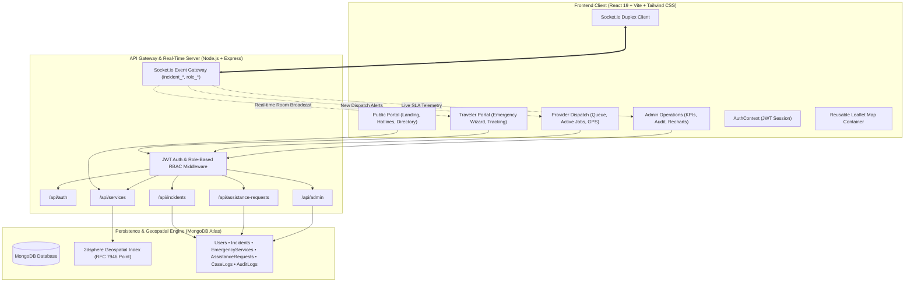
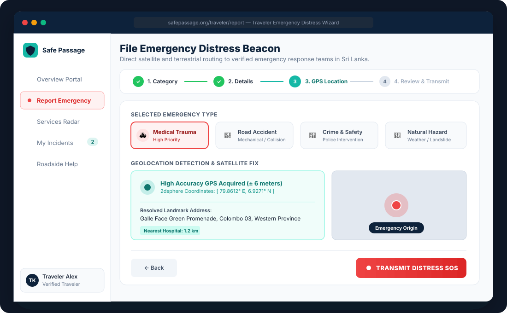
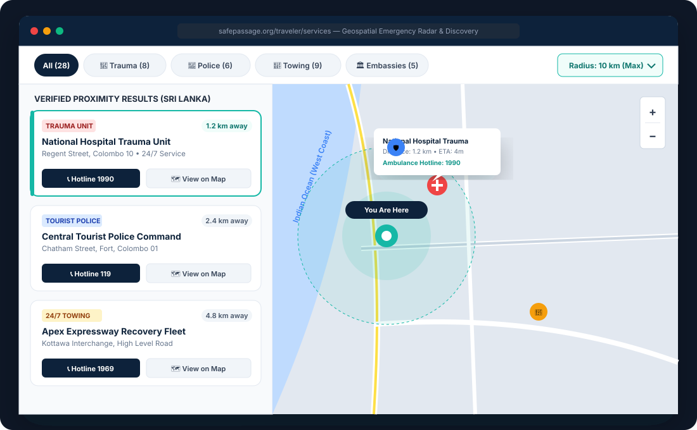
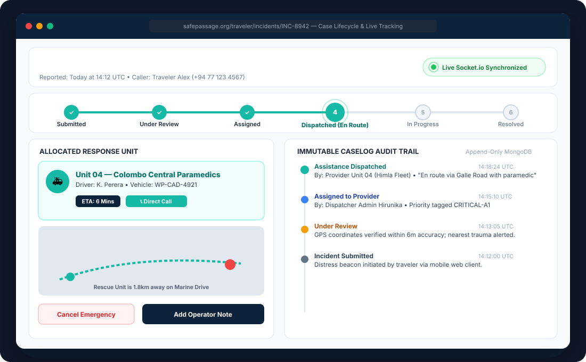
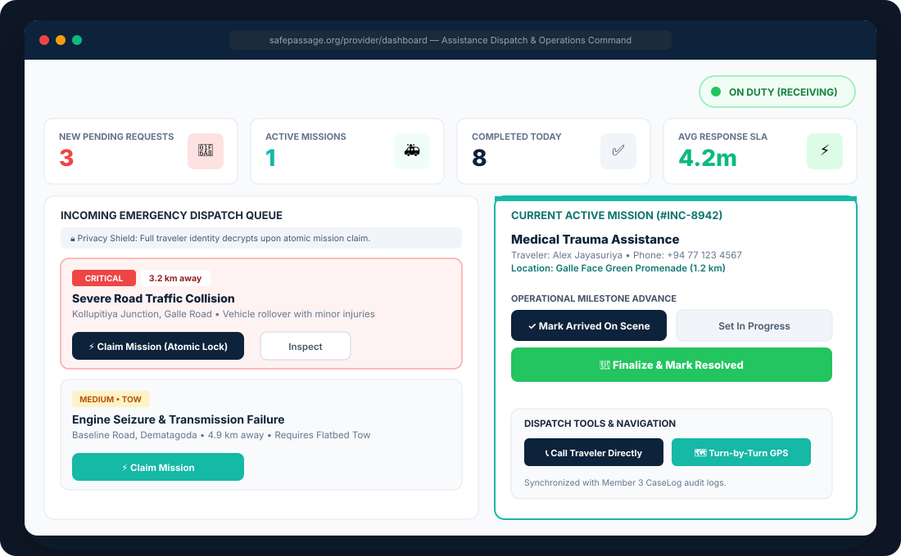
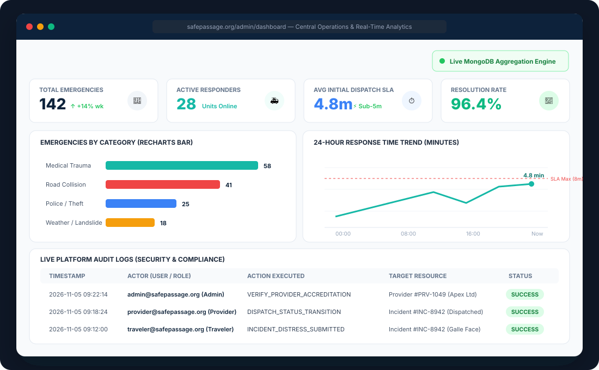
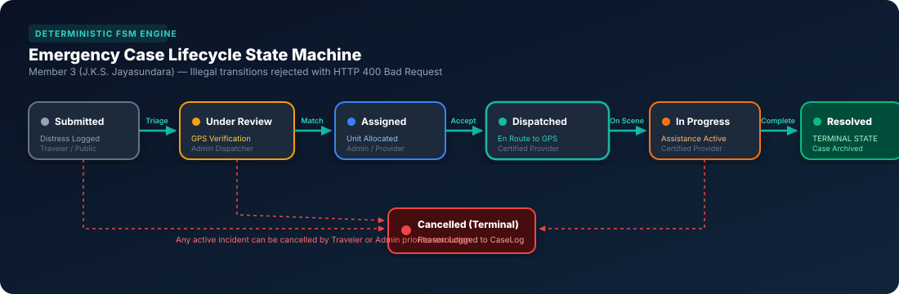

# Safe Passage 🛡️

<div align="center">



<br/><br/>

[](https://react.dev/)
[](https://vitejs.dev/)
[](https://nodejs.org/)
[](https://expressjs.com/)
[](https://www.mongodb.com/)
[](https://socket.io/)
[](https://tailwindcss.com/)
[](./LICENSE)

<br/>

> **"Travel with confidence. Get help when it matters."**  
> *A high-reliability emergency assistance orchestration platform connecting travelers, verified first responders, and operational command centers in real time.*

</div>

---

## 📑 Table of Contents

- [Executive Summary](#-executive-summary)
- [Five-Member Team & Module Ownership](#-five-member-team--module-ownership)
- [System Architecture & Data Flow](#-system-architecture--data-flow)
- [UI Designs & Visual Interface Walkthrough](#-ui-designs--visual-interface-walkthrough)
  - [1. Traveler Emergency Distress Wizard (Module 1)](#1-traveler-emergency-distress-wizard-module-1---dulanjani)
  - [2. Geolocation Radar & Nearby Service Discovery (Module 2)](#2-geolocation-radar--nearby-service-discovery-module-2---samindika)
  - [3. Emergency Case Lifecycle Manager & Real-Time Tracking Room (Module 3)](#3-emergency-case-lifecycle-manager--real-time-tracking-room-module-3---jayasundara)
  - [4. Assistance Dispatch & Service Provider Terminal (Module 4)](#4-assistance-dispatch--service-provider-terminal-module-4---himla)
  - [5. Admin Command Center & Operations Analytics Hub (Module 5)](#5-admin-command-center--operations-analytics-hub-module-5---hirunika)
- [Deterministic Finite State Machine (FSM) Engine](#-deterministic-finite-state-machine-fsm-engine)
- [Design System & UI Components](#-design-system--ui-components)
- [Technology Stack](#️-technology-stack)
- [REST API Matrix](#-rest-api-matrix)
- [Demo Demonstration Accounts](#-demo-demonstration-accounts)
- [Quick Start Guide](#-quick-start-guide)
- [Environment Configuration](#-environment-configuration)
- [Architecture & Module Documentation](#-architecture--module-documentation)

---

## 🌐 Executive Summary

**Safe Passage** is a mission-critical web application engineered for rapid emergency response, high-precision geospatial resource discovery, and lifecycle incident orchestration. Designed to assist both international visitors and domestic travelers across Sri Lanka, the platform unites travelers in distress with accredited nearby medical facilities, tourist police stations, 24/7 towing fleets, certified mechanics, and foreign embassies.

### Key Operational Pillars:
1. **Sub-Second Real-Time Synchronization:** Duplex WebSocket rooms powered by Socket.io broadcast incident status transitions and operator notes instantaneously to travelers, responders, and dispatchers.
2. **RFC 7946 GeoJSON & 2dsphere Spatial Radar:** High-performance MongoDB geospatial queries locate verified emergency assets within a configurable 5km to 25km radius in milliseconds, backed by an automatic Haversine in-memory fallback.
3. **Deterministic Finite State Machine (FSM):** Guaranteed lifecycle progression prevents illegal status jumps, stale states, or premature closures. Every milestone is permanently recorded in an append-only `CaseLog` audit trail.
4. **Race-Condition-Proof Provider Dispatch:** Atomic MongoDB concurrency locks (`$set` with condition gating) ensure that no two emergency rescue units can claim the same incident.
5. **Live Admin Intelligence & Auditing:** Real-time MongoDB aggregation pipelines compute fleet response SLAs, active case distributions, and immutable security audit logs.

---

## 👥 Five-Member Team & Module Ownership

| Member | Module Scope | Feature Branch | Key Deliverables & UI Routes |
|---|---|---|---|
| **K.H.S. Dulanjani** | **Emergency Reporting System** (Module 1) | `feature/emergency-reporting` | Multi-step SOS wizard, severity classification, EXIF photo uploads, GPS coordinates fix (`/traveler/report`, `/traveler/incidents`) |
| **J.D.R. Samindika** | **Geolocation & Service Discovery** (Module 2) | `feature/service-discovery` | Leaflet interactive map, 2dsphere proximity radius search, category chips, emergency hotline integration (`/traveler/services`, `/traveler/map`) |
| **J.K.S. Jayasundara** | **Emergency Case Lifecycle Manager** (Module 3) | `feature/case-management` | Deterministic FSM state engine, real-time live case rooms, immutable `CaseLog` history, cancellation safeguard (`/traveler/incidents/:id`) |
| **M.H.F. Himla** *(Leader)* | **Assistance Dispatch & Provider Portal** (Module 4) | `feature/provider-dispatch` | Duty status toggle, atomic mission claim locking, active job milestone stepper, traveler privacy shield (`/provider/dashboard`, `/provider/jobs`) |
| **R.P.J.H. Hirunika** | **Admin Analytics & Operations Dashboard** (Module 5) | `feature/admin-analytics` | Executive KPI cards, Recharts category breakdown & SLA lines, provider verification, security audit logging (`/admin/dashboard`, `/admin/analytics`) |

---

## 🏗️ System Architecture & Data Flow



---

## 🎨 UI Designs & Visual Interface Walkthrough

Every interface in Safe Passage is crafted in strict adherence to our shared design tokens, prioritizing high contrast in life-safety emergencies and visual clarity across all screen viewports.

### 1. Traveler Emergency Distress Wizard (Module 1 — Dulanjani)
> **Route:** `/traveler/report` | **Primary Goal:** Guide a stressed user through transmitting a verified distress beacon with high-accuracy GPS coordinates in under 30 seconds.

<div align="center">
  
</div>

#### Key UI/UX Capabilities:
- **4-Phase Progress Indicator:** Clear visual stepper (`Category & Severity` ➔ `Incident Details` ➔ `GPS Location` ➔ `Review & Transmit`).
- **Emergency Category Cards:** Immediate visual selection with icons for Medical Trauma, Roadside Collision, Police/Security, and Natural Hazards.
- **Automated GPS Coordinate Fix:** Native HTML5 Geolocation with automatic reverse-geocoding, landmark resolution, and fallback pin-drop.
- **Urgent Action Contrast:** Distinct red gradient SOS beacon button with validation protection against accidental taps.

---

### 2. Geolocation Radar & Nearby Service Discovery (Module 2 — Samindika)
> **Route:** `/traveler/services` & `/traveler/map` | **Primary Goal:** Provide instant situational awareness with live geospatial filtering of emergency assets.

<div align="center">
  
</div>

#### Key UI/UX Capabilities:
- **Split-Screen Ergonomics:** 40% scrollable proximity cards list on the left with 60% interactive Leaflet OpenStreetMap canvas on the right.
- **Dynamic Proximity Radius Selector:** Real-time radius slider/dropdown (5 km, 10 km, 25 km) that adjusts the circular radar scanning envelope.
- **Categorical Asset Filtering:** Pill buttons with badge counters for Trauma Hospitals (`1990`), Police Stations (`119`), Towing Services (`1969`), and Embassies.
- **Bidirectional Map Synchronization:** Hovering or clicking a service card highlights and pans to the corresponding pin on the Leaflet map with interactive popups.

---

### 3. Emergency Case Lifecycle Manager & Real-Time Tracking Room (Module 3 — Jayasundara)
> **Route:** `/traveler/incidents/:id` | **Primary Goal:** Provide transparent, live status progression and accountability from initial distress transmission to safe resolution.

<div align="center">
  
</div>

#### Key UI/UX Capabilities:
- **Real-Time FSM Stepper:** Visual progression through the 6 canonical lifecycle states with active pulse indicators on the current milestone.
- **Socket.io Live Sync Indicator:** Persistent connection badge showing duplex connectivity to the specific case room (`incident_:id`).
- **Response Unit Profile Card:** Displays the allocated provider unit name, driver contact, vehicle registration number, and live estimated time of arrival (ETA).
- **Append-Only Immutable CaseLog Audit Trail:** Chronological timeline showing exact timestamps, actor identity badges (Traveler, Dispatcher, Provider), and timestamped operational notes.
- **Safe Cancellation Guard:** ConfirmDialog preventing accidental cancellations with mandatory audit reason logging.

---

### 4. Assistance Dispatch & Service Provider Terminal (Module 4 — Himla)
> **Route:** `/provider/dashboard` & `/provider/jobs` | **Primary Goal:** Empower verified first responders and recovery fleets to inspect, claim, and fulfill rescue missions efficiently.

<div align="center">
  
</div>

#### Key UI/UX Capabilities:
- **Operational KPI Dashboard:** High-visibility metrics for New Pending Dispatches, Active Missions, Completed Today, and Average Response SLA.
- **Duty State Toggle:** Instant toggle between `Available (On-Duty)` and `Off-Duty` to control queue dispatch eligibility.
- **Traveler Privacy Shield Protocol:** Traveler personal phone numbers and names remain masked while requests are in the public queue, decrypting only after an accredited unit executes an atomic claim.
- **Milestone Operational Controls:** Rapid single-click transitions (`Mark Arrived On Scene`, `Set In Progress`, `Finalize & Mark Resolved`) synchronizing directly with Member 3's CaseLog.

---

### 5. Admin Command Center & Operations Analytics Hub (Module 5 — Hirunika)
> **Route:** `/admin/dashboard` & `/admin/analytics` | **Primary Goal:** Central operational governance, emergency SLA monitoring, directory verification, and audit logging.

<div align="center">
  
</div>

#### Key UI/UX Capabilities:
- **Executive Platform Health KPIs:** Live telemetry on Total Emergencies (142), Online Responders (28), Initial Dispatch SLA (4.8 min), and Resolution Rate (96.4%).
- **Live Data Source Transparency:** Explicit status badge confirming whether metrics derive from active MongoDB Aggregation Pipelines or sandbox memory fallback.
- **Recharts Analytics Engine:** Interactive SVG visualizations including emergency category distribution bars and 24-hour response latency trend lines.
- **Platform-Wide Security Audit Log:** Tabular log recording administrative mutations (user suspensions, provider accreditations, service edits) with IP addresses and actor stamps.

---

## ⚙️ Deterministic Finite State Machine (FSM) Engine

The heart of Safe Passage's reliability is its strict Finite State Machine engine led by **J.K.S. Jayasundara (Member 3)**. Any out-of-order state jump is rejected at the API gateway with `HTTP 400 Bad Request (ILLEGAL_STATUS_TRANSITION)`.

<div align="center">
  
</div>

### State Transition & Role Authorization Matrix:

| Current State | Permitted Next States | Authorized Roles | Operational Description |
|---|---|---|---|
| **Submitted** | `Under Review`, `Cancelled` | Admin, Traveler *(cancel)* | Distress beacon received and logged into database with coordinates. |
| **Under Review** | `Assigned`, `Cancelled` | Admin, Traveler *(cancel)* | Dispatcher verifies coordinates, validates severity, and matches unit. |
| **Assigned** | `Assistance Dispatched`, `Cancelled` | Provider, Admin, Traveler *(cancel)* | Response crew accepts the dispatch mission and departs base. |
| **Assistance Dispatched** | `In Progress`, `Cancelled` | Provider, Admin | Responding crew arrives on scene; initiates rescue/towing operation. |
| **In Progress** | `Resolved`, `Cancelled` | Provider, Admin | Direct emergency assistance completed safely. Case is closed. |
| **Resolved** *(Terminal)* | *None (Immutable)* | — | Case permanently locked. Mutating requests return `HTTP 400 TERMINAL_STATE`. |
| **Cancelled** *(Terminal)* | *None (Immutable)* | — | Incident terminated early. Requires cancellation reason in `CaseLog`. |

---

## 🎨 Design System & UI Components

The Safe Passage user interface is built upon a cohesive, accessible design system defined in [`docs/design-system.md`](./docs/design-system.md).

### Design Tokens & Color Palette:

| Token Name | Hex Code | Utility Class | Semantic Purpose |
|---|---|---|---|
| **Brand Navy** | `#10243A` | `bg-brand-navy`, `text-brand-navy` | Navigation headers, modals, authoritative titles |
| **Secondary Navy** | `#183B56` | `bg-brand-navy-light` | Sidebar backgrounds, dark card headers |
| **Brand Teal** | `#14B8A6` | `bg-brand-teal`, `text-brand-teal` | Primary brand actions, safe beacons, active steppers |
| **Canvas Background** | `#F5F8FC` | `bg-brand-bg` | Off-white page canvas (prevents screen glare) |
| **Emergency Red** | `#EF4444` | `bg-emergency-red` | Distress SOS buttons, critical severity tags, danger dialogs |
| **Warning Amber** | `#F59E0B` | `bg-warning-amber` | Pending review status, medium severity alerts |
| **Success Green** | `#22C55E` | `bg-success-green` | Resolved status, verified provider badge, online indicators |

### 20 Standard Shared UI Components:
All 5 team modules import standardized atomic components from `client/src/components/common/`:
1. `BrandLogo` • 2. `PublicNavbar` • 3. `DashboardSidebar` • 4. `DashboardTopbar` • 5. `Button` • 6. `Input` • 7. `Select` • 8. `Card` • 9. `StatusBadge` • 10. `Table` • 11. `Modal` • 12. `ConfirmDialog` • 13. `ToastNotification` • 14. `LoadingSpinner` • 15. `EmptyState` • 16. `ErrorState` • 17. `SearchBar` • 18. `FilterControls` • 19. `PageHeader` • 20. `MapContainer`

---

## 🛠️ Technology Stack

```
Frontend:   React 19 • Vite 6 • Tailwind CSS 3.4 • React Router v7 • Leaflet 1.9 • Recharts 2.15 • Lucide Icons
Backend:    Node.js 20+ • Express.js 4.21 • MongoDB 8.9 • Mongoose ODM • Socket.io 4.8 • JWT • bcryptjs
Spatial:    MongoDB 2dsphere Geospatial Index • RFC 7946 GeoJSON Point • OpenStreetMap Tiles
Testing:    Oxlint • Vitest • Supertest • Postman Collections
```

---

## 🔌 REST API Matrix

| Method | Endpoint | Access Level | Description |
|---|---|---|---|
| `POST` | `/api/auth/register` | Public | Create new Traveler or Service Provider account |
| `POST` | `/api/auth/login` | Public | Authenticate user credentials and return JWT token |
| `GET` | `/api/auth/me` | Protected | Fetch currently authenticated user profile |
| `POST` | `/api/incidents` | Traveler, Admin | Submit new emergency distress beacon with GPS coordinates |
| `GET` | `/api/incidents` | Protected | Query incidents with role-scoped filtering |
| `GET` | `/api/incidents/:id` | Protected | Get full incident details, assigned unit, and CaseLogs |
| `PATCH`| `/api/incidents/:id/status` | Role-Enforced | Execute FSM status transition with CaseLog logging |
| `POST` | `/api/incidents/:id/logs` | Protected | Append operational note to immutable CaseLog timeline |
| `GET` | `/api/services/nearby` | Public | 2dsphere geospatial radius search (`lat`, `lng`, `radiusKm`) |
| `POST` | `/api/assistance-requests/:id/claim`| Provider | Atomic concurrency lock to claim an emergency mission |
| `GET` | `/api/admin/analytics` | Admin Only | Live MongoDB aggregations for platform KPIs and SLA trends |
| `GET` | `/api/admin/audit-logs` | Admin Only | System security and administrative compliance audit trail |

---

## 🔑 Demo Demonstration Accounts

Pre-seeded accounts for immediate assessment across all three portal roles:

| Portal Role | Demo Email Address | Password | Primary Interfaces |
|---|---|---|---|
| **Traveler** | `traveler@safepassage.org` | `traveler123` | `/traveler/report`, `/traveler/services`, `/traveler/incidents` |
| **Provider** | `provider@safepassage.org` | `provider123` | `/provider/dashboard`, `/provider/requests`, `/provider/jobs` |
| **Admin** | `admin@safepassage.org` | `admin123` | `/admin/dashboard`, `/admin/incidents`, `/admin/analytics` |

---

## 🚀 Quick Start Guide

### Prerequisites
- **Node.js**: v18.0 or higher (v20+ LTS recommended)
- **npm**: v9.0 or higher
- **MongoDB**: Local daemon running on `localhost:27017` or MongoDB Atlas URI

### 1. Clone the Repository
```bash
git clone https://github.com/<your-org>/safe-passage.git
cd safe-passage/Safe_Passage
```

### 2. Install Workspace Dependencies
```bash
# Installs root, client, and server dependencies in one command
npm run install:all
```

### 3. Configure Environment Files
```bash
# Setup frontend client configuration
cp client/.env.example client/.env

# Setup backend API server configuration
cp server/.env.example server/.env
```

### 4. Launch the Development Environment
```bash
# Option A: Run client and server concurrently
npm run dev

# Option B: Run in separate terminal sessions
npm run dev:client  # React frontend on http://localhost:5173
npm run dev:server  # Express API server on http://localhost:5000
```

---

## ⚙️ Environment Configuration

### Client Configuration (`client/.env`)
```ini
VITE_API_URL=http://localhost:5000/api
VITE_SOCKET_URL=http://localhost:5000
VITE_MAP_DEFAULT_LAT=6.9271
VITE_MAP_DEFAULT_LNG=79.8612
VITE_MAP_DEFAULT_ZOOM=13
```

### Server Configuration (`server/.env`)
```ini
PORT=5000
NODE_ENV=development
MONGO_URI=mongodb://localhost:27017/safepassage
JWT_SECRET=your_super_secret_jwt_key_here
JWT_EXPIRE=30d
CLIENT_URL=http://localhost:5173
```

---

## 📖 Architecture & Module Documentation

Deep technical contracts and module blueprints are documented in [`docs/`](./docs/):
- 📘 [System Architecture & Engineering Blueprint](./docs/architecture.md)
- 🎨 [UI/UX Design System & Component Library](./docs/design-system.md)
- 🔌 [Complete REST API Specifications](./docs/api-contracts.md)
- 🗄️ [Database Schemas & Spatial Index Guide](./docs/database-schema.md)
- 👥 [Team Responsibilities & Feature Boundaries](./docs/team-responsibilities.md)
- 🔄 [Integration Plan & Git Workflow](./docs/integration-plan.md)
- 📋 [Case Lifecycle Module Specification (Member 3 — Jayasundara)](./docs/CASE_LIFECYCLE_MODULE_JAYASUNDARA.md)
- 📋 [Provider Dispatch Module Specification (Member 4 — Himla)](./docs/PROVIDER_DISPATCH_MODULE_HIMLA.md)
- 📋 [Admin Analytics Module Specification (Member 5 — Hirunika)](./docs/ADMIN_ANALYTICS_MODULE_HIRUNIKA.md)
- 📋 [Geolocation & Service Discovery Specification (Member 2 — Samindika)](./docs/GEOLOCATION_SERVICE_DISCOVERY_MODULE_SAMINDIKA.md)

---

<div align="center">
  <sub>Built with pride by the Safe Passage Engineering Team. Committed to saving lives through rapid, reliable, and accessible software engineering.</sub>
</div>
