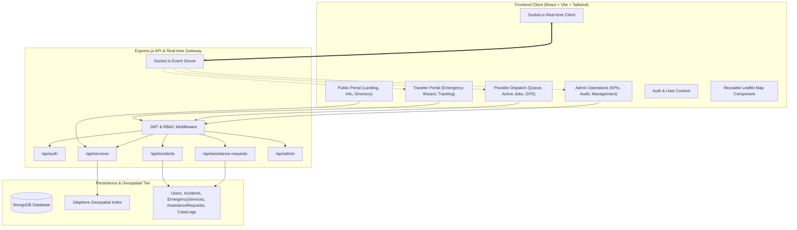

# Safe Passage — System Architecture & Engineering Blueprint

## 1. Executive Summary

**Safe Passage** is a mission-critical web application designed to connect international and domestic travelers with immediate local emergency assistance, verified support providers, and centralized incident monitoring. 

The application is architected to support **high reliability, ultra-low latency dispatching, geospatial radius lookups, and clear separation of concerns** across a 5-member development team led by Himla.

---

## 2. High-Level Architectural Diagram



---

## 3. Technology Stack Justification

| Layer | Technology | Version | Rationale & University Project Fit |
|---|---|---|---|
| **Frontend Framework** | React + Vite | React 19 / Vite 6 | Sub-second hot-module replacement, tree-shaking, fast browser execution |
| **Styling & Design** | Tailwind CSS + Custom Tokens | v3.4 | Unified design tokens, rapid responsive layout without CSS conflicts |
| **Icons & Visuals** | Lucide React | v1.16+ | Clean, consistent SVG icon set matching modern SaaS aesthetics |
| **Interactive Maps** | Leaflet + React Leaflet | v1.9 / v5.0 | Lightweight, OpenStreetMap compatible, zero API billing requirements |
| **Analytics Charts** | Recharts | v2.15+ | Declarative SVG charting for Admin KPIs and trend visualization |
| **Backend Framework** | Node.js + Express.js | Node 20+ / Express 4.21 | Lightweight asynchronous event loop, widespread industry adoption |
| **Database & ODM** | MongoDB + Mongoose | v8.9 | Native GeoJSON Point support, `$nearSphere` queries, schema validation |
| **Security & Auth** | JWT + bcryptjs | v9.0 / v2.4 | Stateless cryptographic tokens with secure role-based access control |
| **Real-time Engine** | Socket.io | v4.8 | Low-latency duplex communication for live status changes and location pings |

---

## 4. Directory Structure & Separation of Concerns

```
safe-passage/
├── client/                     # Vite React Frontend Application
│   ├── public/                 # Static assets, logos, favicons
│   ├── src/
│   │   ├── assets/             # Brand graphics and illustrations
│   │   ├── components/
│   │   │   ├── common/         # 20+ Reusable Atomic UI Components (Buttons, Modals, Cards)
│   │   │   ├── layout/         # Public Navbar, Footer, Dashboard Sidebar, Topbar
│   │   │   └── maps/           # Leaflet reusable map component & markers
│   │   ├── context/            # AuthContext, ToastContext, SocketContext
│   │   ├── features/
│   │   │   ├── reporting/      # Member 1: Emergency reporting wizard & photo capture
│   │   │   ├── service-discovery/ # Member 2: Map exploration, category filtering, search
│   │   │   ├── case-management/# Member 3: Status progression & case timeline logs
│   │   │   ├── dispatch/       # Member 4 (Himla): Provider queue, job response, navigation
│   │   │   └── analytics/      # Member 5: Recharts dashboards & system audit logs
│   │   ├── layouts/            # PublicLayout, TravelerLayout, ProviderLayout, AdminLayout
│   │   ├── pages/              # Route views for Public, Traveler, Provider, Admin
│   │   ├── services/           # Axios/Fetch API client wrappers with auth headers
│   │   ├── styles/             # Global CSS and custom animations
│   │   ├── App.jsx             # React Router routing configuration
│   │   └── main.jsx            # Application entry point
│   ├── tailwind.config.js      # Brand design tokens configuration
│   └── package.json
│
├── server/                     # Express.js REST API Server
│   ├── config/                 # Database configuration (db.js)
│   ├── controllers/            # Controller handlers isolated by domain
│   ├── middleware/             # Auth check, Role RBAC, Global Error Handling
│   ├── models/                 # Mongoose Data Schemas (User, Incident, etc.)
│   ├── routes/                 # Express routers mapping endpoints
│   ├── sockets/                # Socket.io event listeners & room emitters
│   ├── utils/                  # Seed scripts and coordinate calculators
│   ├── app.js                  # Express middleware setup
│   ├── server.js               # HTTP + Socket.io server bootstrap
│   └── package.json
│
├── docs/                       # Shared Architectural & Contract Documentation
│   ├── architecture.md
│   ├── design-system.md
│   ├── api-contracts.md
│   ├── database-schema.md
│   ├── team-responsibilities.md
│   └── integration-plan.md
│
├── .gitignore                  # Protection against secret leakage and bulky files
├── README.md                   # Setup guide and repository documentation
└── package.json                # Monorepo root orchestration scripts
```

---

## 5. Security Architecture

1. **Authentication:** Stateless JSON Web Tokens (JWT) signed with HMAC-SHA256. Stored in browser `localStorage` or secure session cookie.
2. **Role-Based Access Control (RBAC):** Every non-public API endpoint is guarded by `protect` and `authorize('traveler' | 'provider' | 'admin')`. The frontend route guards verify the authenticated user's role before mounting role layouts.
3. **Password Security:** Salted hashing with `bcryptjs` (work factor 10). Password hashes are set with `select: false` on Mongoose queries to prevent accidental leakage in JSON serialization.
4. **Input Validation:** Strict type casting and regex validation on emails, coordinates, and enum status transitions.
